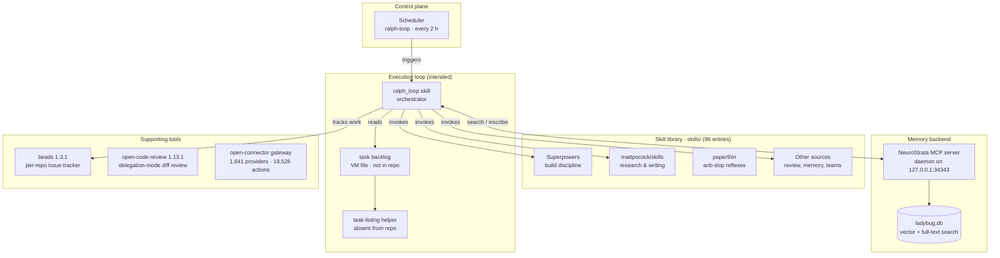
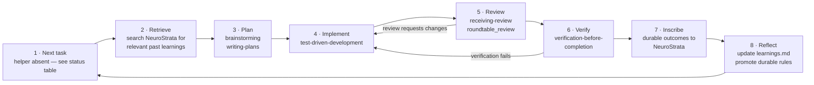

# Autonomous Engineering Platform

Reference architecture and runbook for an autonomous software-engineering environment: a skill library, an execution loop, a persistent memory backend, and supporting tooling. Built and verified 2026-10-16 on a persistent Linux VM (x86_64).

## Ecosystem



- [ESF reference](docs/esf-reference.md) — vendored snapshot of pratik-saptarshi/esf (Engineering Software Factory) with build/verification notes.
- [Security-audit skill reference](docs/security-audit-reference.md) — vendored snapshot of pratik-saptarshi/security-audit-skill (fork of cloudflare/security-audit-skill) with audit-methodology notes.
- [Ub-mode skill reference](docs/ub-mode-reference.md) — vendored snapshot of pratik-saptarshi/ub-mode (fork of unclebob/ub-mode) with notes on its companion quality-gate tools.

## Continuous loop cycle

Intended cycle (efficacy not demonstrated in this repo):



Guards: at most 6 iterations per run. Three failed attempts on one task stops the loop for human arbitration. An empty backlog ends the run silently.

## Component status

Implemented means present in this repo; Absent means referenced but not present; External-only means it lives on the deployed VM, not in this repo. The canonical verifier is `scripts/mechanical_verify.py` (see [verifier of record](docs/decisions/verifier-of-record.md)).

| Component | Location in this repo | Status |
| --- | --- | --- |
| Skill library (96 entries: 95 skill dirs + `skills/README.md`) | `skills/` | Implemented |
| Ralph loop orchestrator skill | `skills/ralph_loop/` | Implemented |
| Ralph loop task-listing helper | none — repo-wide filename search (including `reference/`) finds no such helper; the only `backlog*` match is `reference/esf/docs/backlog/`, a vendored docs page | Absent |
| Mechanical verifier, Python (~5354 lines) | `scripts/mechanical_verify.py` | Implemented |
| Verifier runner, Go (~338 lines) | `internal/verifier/runner/runner.go` | Implemented |
| Canonical verifier | `scripts/mechanical_verify.py` (see [verifier of record](docs/decisions/verifier-of-record.md)) | Implemented |
| Runbook and operations docs | `docs/runbook.md`, `docs/operations.md`, `docs/limitation-analysis.md` | Implemented |
| Daemon watchdog + backup script | `scripts/watchdog-backup.sh` | Implemented |
| NeuroStrata engine, memory store, model cache, beads, open-code-review, open-connector, scheduler | External-only — see deployed paths below | External-only |

The per-source skill counts previously listed here were unverified against this repo and have been removed; provenance notes live with the skills themselves and in `docs/paperthin-skills.md`.

### Deployed VM paths — not in this repo

The paths below describe the persistent Linux VM where the environment was built and verified. They are historical deployment notes, not contents of this repo.

| Item | Deployed location | Last reported state on VM |
| --- | --- | --- |
| Skill library (deployed copy) | `~/workspace/custom-skills/` | Reported installed on VM |
| Ralph loop (deployed copy) | `~/workspace/ralph/` | Reported scheduled every 2 h on VM |
| NeuroStrata engine (v1.9.0 prebuilt binary) | `~/workspace/neurostrata/` | Reported live on VM |
| NeuroStrata MCP connector (custom stdio client) | `~/workspace/custom-connectors/custom.neurostrata/` | Reported registered on VM |
| Embedding model cache (nomic-embed-text-v1.5, 523 MB) | `~/.cache/neuro/models/fastembed` | Reported pre-seeded on VM |
| Memory store (ladybug.db) | `~/.config/NeuroStrata/data/db/` | Reported live on VM |
| beads (v1.3.1) | `~/workspace/bin/bd` | Reported installed on VM |
| open-code-review (v1.13.1) | `~/workspace/bin/ocr` | Reported installed on VM |
| open-connector (catalog 1,641 / 19,526) | `~/workspace/open-connector/` | Reported installed on VM |
| Scheduler jobs (`ralph-loop`, `neurostrata-watchdog`, `neurostrata-tls-validation`) | cron | Reported active on VM |

## Repository layout

```text
README.md            this file
docs/runbook.md      exact steps to reproduce the environment
docs/paperthin-skills.md
                     catalog of the 28 vendored paperthin skills
docs/operations.md   operating the platform: scheduler, daemon, memory, troubleshooting
docs/limitation-analysis.md
                     root-cause analysis of the five documented limitations
scripts/watchdog-backup.sh
                     nohup-aware daemon watchdog + change-detected DB backup
```

## Known limitations

Full root-cause analysis: [docs/limitation-analysis.md](docs/limitation-analysis.md).

- The NeuroStrata daemon runs under `nohup`, not systemd: this environment has no user D-Bus, so the shipped user units are staged but inactive. Mitigated by a watchdog cron (every 2 h) that revives a dead daemon via direct `nohup` restart and takes change-detected database backups to Google Drive. A bare MCP spawn does not reliably restart a dead daemon (verified 2026-10-16), so recovery never depends on it. The root cause of repeated unexpected daemon deaths (three on 2026-10-18) is still open, so supervision is only partially mitigated. The canonical watchdog now captures crash evidence (see `docs/limitation-analysis.md` section 1).
- The binary cannot download its embedding model through a TLS-intercepting egress proxy (rustls does not trust the proxy CA). Mitigated: the model cache is pre-seeded, a compressed backup is kept in the workspace, and `HF_HUB_OFFLINE=1` is set on the daemon and the MCP client so a cache miss fails fast with a clear error instead of an opaque TLS failure.
- The open-connector gateway does not survive VM restarts. Mitigated: `oc.py` auto-starts it when a command finds it down; start it by hand with `start.sh` when preferred.
- The sandbox egress guard blocks provider hosts until allowlisted. Managed through `egress-allowlist.conf`, which `start.sh` reads on every start.
- `bd doctor` is only partially supported in embedded mode; the available checks pass. Accepted as a limitation: the realistic failure modes are covered by the working checks plus the open-time schema guard.
