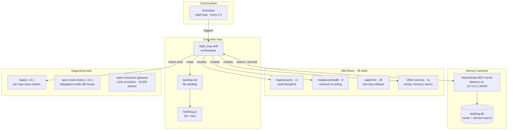
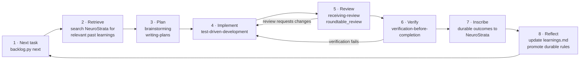

# Autonomous Engineering Platform

Reference architecture and runbook for an autonomous software-engineering environment: a skill library, an execution loop, a persistent memory backend, and supporting tooling. Built and verified 2026-10-16 on a persistent Linux VM (x86_64).

## Ecosystem



- [ESF reference](docs/esf-reference.md) — vendored snapshot of pratik-saptarshi/esf (Engineering Software Factory) with build/verification notes.

## Continuous loop cycle

Every scheduled run executes this cycle, one verified task per iteration:



Guards: at most 6 iterations per run. Three failed attempts on one task stops the loop for human arbitration. An empty backlog ends the run silently.

## Component inventory

| Component | Version | Location | Status |
|---|---|---|---|
| Skill library | 58 skills, 12 upstream sources | `~/workspace/custom-skills/` | Installed, verified |
| Ralph loop | skill + `backlog.py` | `~/workspace/ralph/` | Installed; scheduled every 2 h |
| NeuroStrata engine | v1.9.0 (prebuilt binary) | `~/workspace/neurostrata/` | Live; daemon healthy |
| NeuroStrata MCP connector | custom stdio client | `~/workspace/custom-connectors/custom.neurostrata/` | Registered; round-trip verified |
| Embedding model cache | nomic-embed-text-v1.5 | `~/.cache/neuro/models/fastembed` | Pre-seeded (523 MB) |
| Memory store | ladybug.db | `~/.config/NeuroStrata/data/db/` | Live |
| beads | v1.3.1 | `~/workspace/bin/bd` | Installed; lifecycle verified |
| open-code-review | v1.13.1 | `~/workspace/bin/ocr` | Installed; delegation mode verified |
| open-connector | catalog 1,641 / 19,526 | `~/workspace/open-connector/` | Installed; start/stop verified |
| Scheduler | jobs `ralph-loop` (2 h), `neurostrata-watchdog` (2 h), `neurostrata-tls-validation` (one-shot) | cron | Active |

### Skill sources

| Upstream | Skills adapted |
|---|---|
| obra/superpowers | brainstorming, dispatching-parallel-agents, executing-plans, receiving-review, requesting-review, subagent-driven-development, systematic-debugging, test-driven-development, verification-before-completion, writing-plans, writing-skills |
| mattpocock/skills | grilling, prototype, recurring-workflows, research, teach, to-questionnaire, writing-articles, writing-for-agents |
| pratik-saptarshi/NeuroStrata | neurostrata_memory |
| Cognilogical/NeuroPlasticity | self_test_gym |
| Cognilogical/NeuroGenesis | neurogenesis_teams |
| LilMGenius/paperthin | re0, readchk, aim, modelchk, hate, macrothink, feynman, autobahn, reorder, detool, dedash, debloat, shower, factchk, mandela, sip, re0-git, re0-release, re0-merge, ssotize, re0-upgrade, re0-plan, re0-loop, re0-memo, re0-work, catchup, nba, prism (see [docs/paperthin-skills.md](docs/paperthin-skills.md)) |
| humanlayer/12-factor-agents | agent_operations |
| pratik-saptarshi/opencode-rountable-review | plan_review_integrator, roundtable_review |
| zomars/ralph | ralph_loop |
| Jakevin/fastcontext-agent-tools | code_explorer |
| morluto/rea | reverse_engineering |
| alibaba/open-code-review | delegate_code_review |

SWE-bench was evaluated and deliberately skipped. The `fastcontext` upstream package was uninstallable (repository unreachable); only its methodology was adapted.

## Repository layout

```text
README.md            this file
docs/runbook.md      exact steps to reproduce the environment
docs/paperthin-skills.md
                     catalog of the 28 vendored paperthin skills
docs/operations.md   operating the platform: scheduler, daemon, memory, troubleshooting
docs/limitation-analysis.md
                     root-cause analysis of the five documented limitations
scripts/watchdog-backup.sh
                     nohup-aware daemon watchdog + change-detected DB backup
```

## Known limitations

Full root-cause analysis: [docs/limitation-analysis.md](docs/limitation-analysis.md).

- The NeuroStrata daemon runs under `nohup`, not systemd: this environment has no user D-Bus, so the shipped user units are staged but inactive. Mitigated by a watchdog cron (every 2 h) that revives a dead daemon via MCP auto-spawn, and change-detected database backups to Google Drive. A dead daemon is also restarted automatically on the next MCP spawn.
- The binary cannot download its embedding model through a TLS-intercepting egress proxy (rustls does not trust the proxy CA). Mitigated: the model cache is pre-seeded, a compressed backup is kept in the workspace, and `HF_HUB_OFFLINE=1` is set on the daemon and the MCP client so a cache miss fails fast with a clear error instead of an opaque TLS failure.
- The open-connector gateway does not survive VM restarts. Mitigated: `oc.py` auto-starts it when a command finds it down; start it by hand with `start.sh` when preferred.
- The sandbox egress guard blocks provider hosts until allowlisted. Managed through `egress-allowlist.conf`, which `start.sh` reads on every start.
- `bd doctor` is only partially supported in embedded mode; the available checks pass. Accepted as a limitation: the realistic failure modes are covered by the working checks plus the open-time schema guard.
