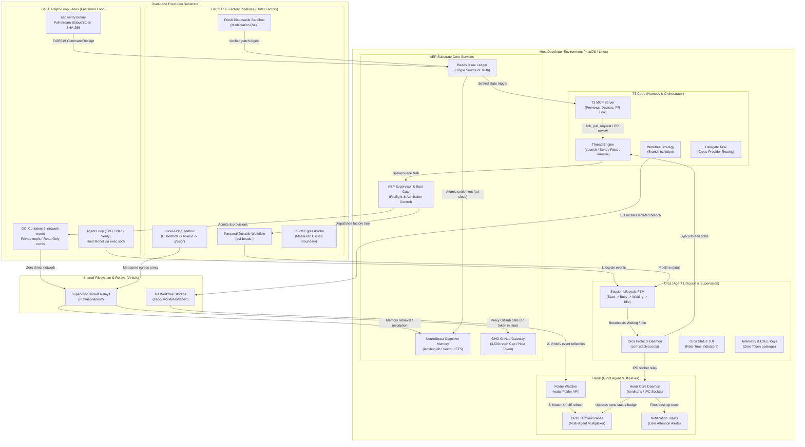
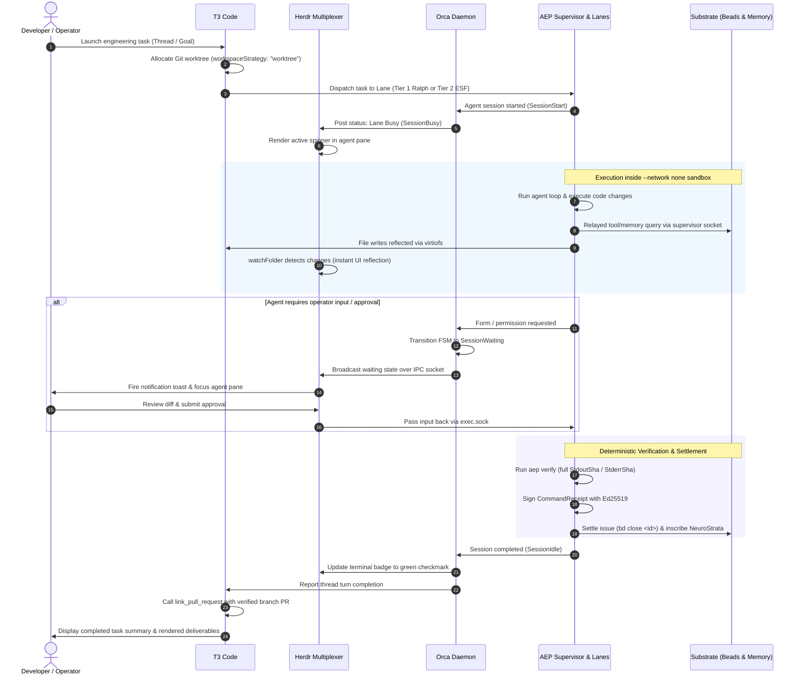

# Integration Patterns Across T3 Code, Herdr, and Orca (v1.2)

**Status:** Immutable Versioned Architecture Artifact · **Version:** v1.2 · **Date:** 2026-11-09  
**Repository:** `autonomous-engineering-platform` · **Branch:** `docs/dual-lane-governance-proposal`  
**PR:** #133 · **Companion Docs:** `aep-architecture-diagrams-v1.2.html`, `aep-hld-v1.2.html`, `aep-lld-v1.2.html`

---

## 1. Executive Overview & The Triad

The Autonomous Engineering Platform (AEP) substrate operates inside a host virtualization boundary (e.g. macOS Apple Silicon `vz` or Linux `cgroups v2`). Above and alongside this substrate, the developer experience and autonomous agent execution are governed by three complementary host systems:

1. **T3 Code (Developer Harness & Orchestration Control Plane):**
   - The primary AI-assisted coding environment, top-level thread orchestrator (`t3_thread_launch`, `create_threads`, `delegate_task`), and preview server (`preview_*`, `html_render`, `html_preview`).
   - Manages isolated Git worktrees via `workspaceStrategy: "worktree"` and links completed branches to GitHub pull requests (`link_pull_request`, `watch_pull_request`).

2. **Herdr (GPUI Agent Workspace & Terminal Multiplexer):**
   - A GPU-accelerated desktop application built on `gpui-kit` managing parallel agent terminal panes, editor layouts, and operator attention.
   - Watches worktree folders (`watchFolder`) for instant filesystem events via `virtiofs`, raises notifications/toasts (`notify`) when human-in-the-loop decisions are required, and maintains reactive shared mod state (`shared`, `setShared`).

3. **Orca (Agent Lifecycle, Telemetry & Supervision Protocol):**
   - A background protocol daemon (`com.stablyai.orca`) and plugin system (`orca-opencode-status.js`, `orca-agent-view.json`) governing agent execution state machines.
   - Formalizes turn lifecycles: `SessionStart` → `SessionBusy` → `SessionWaiting` (Permission / Form) → `SessionIdle` (or `SessionError`).
   - Relays agent prompts and streaming assistant messages, enforces zero-token leakage, tracks E2EE keypairs, and synchronizes status badges to Herdr and T3 Code.

---

## 2. Architecture Topology Diagram

---

## 3. Four Core Integration Patterns

### Pattern A: Workspace Multiplexing & Near-Zero-Latency File Reflection
- **Mechanism:** When a task begins, T3 Code allocates an isolated Git worktree under `.worktrees/lane-<id>`.
- **Virtiofs Bridging:** The worktree directory is mounted into the execution lane container or VM using `virtiofs`.
- **Herdr Event Handling:** Herdr's native folder watcher (`watchFolder`) receives inotify/FSEvents instantly across the mount, keeping terminal panes and diff trees updated in real time without polling loops.

### Pattern B: Agent Lifecycle State Machine & Human-in-the-Loop Supervision
- **FSM Synchronization:** As agents execute turns (via OpenCode, Claude Code, or Pi harnesses), the `orca-opencode-status` plugin captures transitions:
  - `SessionStart`: Clears prior run logs and establishes factory session identity.
  - `SessionBusy`: Active model inference and tool calling.
  - `SessionWaiting`: Raised when an agent encounters an interactive permission request, user prompt hook, or confirmation form.
  - `SessionIdle`: Normal turn completion.
  - `SessionError`: Handled failures, timeouts, or cancellations.
- **Herdr Attention Routing:** Orca emits waiting events over the local IPC domain socket (`/Users/neo/.config/herdr-app/herdr-app.sock`). Herdr intercepts the event, raises an interactive desktop notification toast (`notify`), and autofocuses the specific agent pane for operator response.

### Pattern C: Supervisor-Mediated Socket Relays (Zero Token Leakage)
- **Container Network Posture:** Both Ralph OCI lanes and ESF sandboxes execute with strict zero-egress policies (`--network none` or measured in-VM `EgressProbe`).
- **Secret Isolation:** Provider API keys (OpenAI, Anthropic, Gemini) and GitHub Personal Access Tokens (PATs) reside exclusively in host memory and the host `ghg` gateway.
- **Domain Sockets:** Containers communicate solely through host supervisor UNIX domain sockets mounted at `/run/aep/lanes/<laneId>/`:
  - `memory.sock` → Relays hybrid vector / FTS searches to NeuroStrata (`ladybug.db`).
  - `ghg.sock` → Proxies GitHub API requests under a hard 3,500 req/h budget.
  - `git.sock` → Commits verified changes using host SSH/GPG identities.
  - `exec.sock` → Relays tool execution commands from the host-hosted model harness.

### Pattern D: Verifiable Settlement & Ledger Synchronization
- **Receipt Generation:** All lane test executions run through the compiled static Go binary `aep verify`, capturing full-stream `StdoutSha` and `StderrSha` into an RFC 8785 canonical JSON receipt signed with Ed25519.
- **Single Source of Truth:** Beads (`bd list --limit 0`) acts as the single task ledger. Issues cannot close without verified receipt attachment.
- **Continuous Learning:** Upon issue closure (`bd close <issueId>`), root causes, fix diffs, and test failure patterns inscribe into NeuroStrata cognitive memory.
- **PR Linking:** T3 Code's MCP harness intercepts the closure, auto-generates or verifies the pull request, and registers it with `link_pull_request`.

---

## 4. Interaction Sequence Diagram

