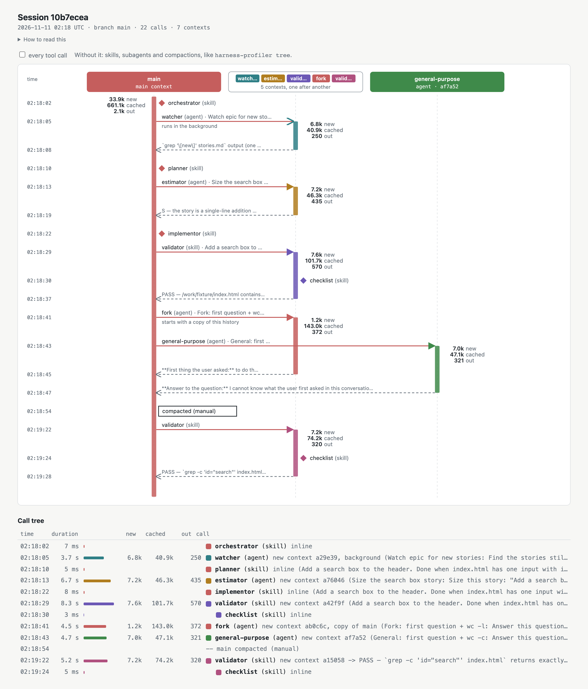

# End-to-end run

A small harness that uses every feature the profiler shows, run headless in Claude Code with the hook installed. The outputs below are from a real session, and `node --test` checks they still match what `hp` renders.



With **every tool call** checked, the same page also shows each shell call, the `Edit`, and the failed `false`: [trace-all-calls.png](claude/output/trace-all-calls.png). The page itself is [trace.html](claude/output/trace.html). GitHub shows its source, so download it to click through.

The text tree, [tree.txt](claude/output/tree.txt):

```
time     duration             new  cached    out  call
02:18:02     7 ms ▎                               orchestrator (skill) inline
02:18:05    3.7 s █████▍     6.8k   40.9k    250  watcher (agent) new context a29e39, background (Watch epic for new stories: Fi…) -> `grep '\[new\]' stories.…
02:18:10     5 ms ▎                               planner (skill) inline (Add a search box to the header. Done when index.html has one input with id "search".)
02:18:13    6.7 s ███████▎   7.2k   46.3k    435  estimator (agent) new context a76046 (Size the search box story: Size thi…) -> S — the story is a single-lin…
02:18:22     8 ms ▎                               implementor (skill) inline (Add a search box to the header. Done when index.html has one input with id "searc…)
02:18:29    8.3 s ████████   7.6k  101.7k    570  validator (skill) new context a42f9f (Add a search box to the header. Don…) -> PASS — /work/fixture/index.ht…
02:18:30     3 ms ▏                                 checklist (skill) inline
02:18:41    4.5 s █████▉     1.2k  143.0k    372  fork (agent) new context ab0c6c, copy of main (Fork: first question + wc -l: …) -> **First thing the user as…
02:18:43    4.7 s ██████     7.0k   47.1k    321  general-purpose (agent) new context af7a52 (General: first question + wc -c:…) -> **Answer to the question:*…
02:18:54                                          -- main compacted (manual)
02:19:22    5.2 s ██████▍    7.2k   74.2k    320  validator (skill) new context a15058 -> PASS — `grep -c 'id="search"' index.html` returns exactly 1, matchin…
02:19:24     5 ms ▎                                 checklist (skill) inline
```

`--verbose` adds every tool call: [tree-verbose.txt](claude/output/tree-verbose.txt). The trace they come from: [trace.jsonl](claude/output/trace.jsonl).

## The harness

Two fixtures, both run by [claude/run.sh](claude/run.sh):

- [toy/fixture/](toy/fixture) is the README's example and nothing else: `orchestrator` starts a `process-story` subagent per new story, which runs `planner` and `implementor`, and `implementor` asks `validator`, in its own context, for `PASS` or `FAIL`. When a story passes, `process-story` uses the forked `github` skill, which writes `pr.md` (no real pull request) and asks `validator` again. `github` is a skill, not a subagent, because a subagent can't start another one. In an earlier run, the trace showed `process-story` look for the Agent tool, not find it, and write `pr.md` itself. Its outputs are in [toy/output/](toy/output).
- [claude/fixture/](claude/fixture) grows the same story until it shows every feature the profiler draws. `orchestrator` waits for a background `watcher` to find the new stories, `planner` sizes each with an `estimator` subagent, and `implementor` runs a failing lint step:

| Feature | Where | Shows as |
| --- | --- | --- |
| Inline skill in main | `orchestrator`, `planner`, `implementor` | diamond on `main`, `(skill)` with no new context in the tree |
| Inline skill calling a forked one | `implementor` uses `validator` | `validator` called from `main` |
| Forked skill (`context: fork`) | `validator` | new bar, fresh, new color |
| Inline skill inside a subagent | `validator` uses `checklist` | diamond on `validator`'s bar |
| Custom subagent | `estimator`, used by `planner` | new bar, fresh |
| Background subagent | `watcher`, started by `orchestrator` with `run_in_background`, then waited for | `, background` in the tree, an open arrowhead in the diagram; its end and result come from `SubagentStop` |
| Failed tool call | `implementor` runs `false` | `failed -> Exit code 1` (with every tool call) |
| `fork` subagent, run in parallel with a fresh one | [PROMPT-1.txt](claude/fixture/PROMPT-1.txt) | bar in `main`'s color, `copy of main` |
| Manual compaction, then more calls | `/compact`, then [PROMPT-2.txt](claude/fixture/PROMPT-2.txt) | note on `main` |
| Tool without a skill or agent | `Read` in PROMPT-2 | only with every tool call |

Both subagents in step 2 are asked for the user's first message. The fresh one says it has none. The `fork` holds `main`'s history and can answer. That is the copy-versus-fresh difference the colors encode, seen from inside.

## Run it again

```
sh e2e/claude/run.sh          # the full fixture, one Claude Code session, about 2 minutes
sh e2e/claude/run.sh e2e/toy  # the README's example, under a minute
node e2e/render.js --png      # tree.txt, tree-verbose.txt, trace.html, the PNGs
node --test                   # checks the features and the outputs
```

`run.sh` copies the fixture to a temporary git repository, installs the hook with `hp init claude`, runs three turns of one session (the prompt, `/compact`, the second prompt), and hands the trace to [collect.js](claude/collect.js). `hp` reads context sizes and token spend from Claude Code's transcripts, which hold the whole conversation and stay on your machine, so `collect.js` commits only what `hp` reads: per model call, the message id, the token usage, and the tool call ids ([transcripts/](claude/output/transcripts)). It also replaces the temporary path with `/work/fixture`, so the committed trace renders the same anywhere.

`run.sh` needs `claude` signed in. If your shell sets an `ANTHROPIC_API_KEY` you don't want, run it under `env -u ANTHROPIC_API_KEY`. `--png` needs Playwright with Chromium, a dev-only dependency. The rest needs only Node.

Model output differs between runs, so a new recording changes ids, times, and results, not the shape. The test checks the shape.

## Codex

Not recorded yet: `hp` has no `capture codex`. [codex/run.sh](codex/run.sh) runs the same fixture in Codex and records the raw hook payloads with the raw recorder [record.sh](codex/record.sh). It needs Codex signed in. It differs from the Claude run where Codex does:

- Skills move to `.agents/skills/`, and `validator` runs inline, because Codex ignores `context: fork`.
- There is no `Agent` tool or custom subagent, so [PROMPT-1](codex/PROMPT-1.txt) asks in words for `spawn_agent` calls: one for each of `watcher` and `estimator`, then a pair, one keeping the history and one without.
- No compaction step: how `/compact` behaves in `codex exec` is unverified.
- Hooks fire only after you trust them once in `/hooks`.

Once the Codex capture lands, `run.sh` switches to `hp capture codex` and gets the same `render.js` outputs and test.
